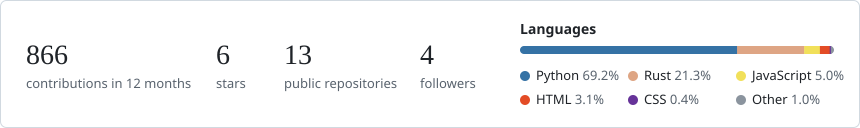

  

  

  <a href="https://wosonday.id.vn/">Website</a> ·
  <a href="https://www.linkedin.com/in/son-thanh-ba-nguyen-03b45130b/">LinkedIn</a> ·
  <a href="https://huggingface.co/wosonday">Hugging Face</a> ·
  <a href="https://wosonday.id.vn/2026_09_NguyenBaThanhSon_Resume.pdf">Resume</a> ·
  <a href="mailto:thanhsonmttn@gmail.com">Email</a>

## About me

Environmental researcher and M.Sc. candidate at **Nong Lam University**, Ho Chi Minh City, Vietnam.
I study hydrology and climate change by combining **physically based models** with **machine learning**,
mostly running SWAT and SWAT+ on Vietnamese river basins, and I build open-source tools that automate
the parts of that work that are repetitive.

- Streamflow simulation, calibration and validation for the Ba, An Lao and Lo river basins
- Climate change and solar geoengineering (SAI, G6sulfur) impacts on flow regimes and agricultural drought
- Hybrid physics + ML models and SWAT parameter regionalization for ungauged basins (NAFOSTED, ongoing)

## Technical skills

  

**Models and methods**

| Area | What I use |
|---|---|
| Hydrological models | **SWAT** (SWAT2012) and **SWAT+**: TxtInOut editing, calibration, validation, sensitivity analysis, land-use and climate scenario batches; weather generator (WGN) statistics |
| Calibration algorithms | **GLUE** (Monte Carlo), **DDS**, Differential Evolution, **PSO**, run in parallel |
| Model evaluation | NSE, KGE, PBIAS, R², RMSE; comparing objective functions for calibration; leave-one-basin-out cross-validation |
| Climate data | **CMIP6** GCM outputs, GeoMIP **G6sulfur** and **SAI** scenarios, station and gridded observations (NetCDF) |
| Bias correction | Empirical quantile mapping, detrended quantile mapping, quantile delta mapping, scaling |
| Climate indices | Standardized Precipitation Index (SPI) and other hydrometeorological drought indicators |
| Machine learning | Linear regression, Random Forest, **XGBoost**, LightGBM; residual error learning to correct SWAT streamflow; SHAP for interpretation |

**Programming languages**

| Language | Used for |
|---|---|
| **Python** | Main language: research pipelines, libraries, CLIs and web apps |
| **R** | Statistical analysis |
| **Rust** | Fast, single-binary command-line and terminal (TUI) tools |

**Libraries and tools**

| Area | Libraries |
|---|---|
| Arrays and data | NumPy, pandas, SciPy, xarray, Dask, netCDF4, h5netcdf, Zarr |
| Geospatial | Rasterio, GeoPandas, Shapely, Fiona, pyproj, GDAL; QGIS and ArcGIS |
| Statistics and ML | scikit-learn, XGBoost, LightGBM, statsmodels, SHAP, xsdba |
| Visualization and apps | Matplotlib, seaborn, Streamlit |
| Packaging and quality | uv, pydantic, click, PyYAML, pytest, ruff, Docker, GitHub Actions |
| Rust crates | clap, ratatui, rusqlite, serde |

## Repositories

**Hydrology and climate**

| Repository | What it does |
|---|---|
| [**SpySWAT**](https://github.com/wosonday/SpySWAT) | Python library and CLI (`spyswat`) for **SWAT calibration, validation, sensitivity analysis and scenario runs**. Calibrates with GLUE, DDS, Differential Evolution or PSO across parallel workers, derives sensitivity from GLUE results without extra SWAT runs, and reads and writes TxtInOut files directly. |
| [**swatprep**](https://github.com/wosonday/swat-preprocessing) | Turns **raw DEM, land-use, soil, weather and streamflow data into model-ready inputs** for SWAT Classic and SWAT+. One YAML file describes the project; every step reports pass / warn / fail checks. Comes with a Streamlit web app and a Docker image. |
| [**bcflow**](https://github.com/wosonday/bcflow) | **Config-driven bias correction** of climate and hydrological data on top of xsdba. Choose the method and parameters in YAML or JSON instead of editing code; configs are validated before any data is opened. |
| [**SWAT_Regression**](https://github.com/wosonday/SWAT_Regression) | Learns SWAT parameters at HRU level from land use, soil and slope so they can be **transferred to ungauged basins across Vietnam**, tested with leave-one-basin-out cross-validation. |
| [**Machine-learning-for-Streamflow-hybrid-model**](https://github.com/wosonday/Machine-learning-for-Streamflow-hybrid-model) | Compares linear regression, Random Forest, XGBoost and tuned XGBoost for **correcting SWAT streamflow errors** under climate change scenarios. |
| [**Hydrometeorology-indicates**](https://github.com/wosonday/Hydrometeorology-indicates) | Computes **drought and climate indices** (such as SPI) from daily station precipitation. |

**Tools**

| Repository | What it does |
|---|---|
| [**agmag**](https://github.com/wosonday/agmag) | Rust control panel (`agm`) for **teams of AI coding agents** (Claude Code, Codex, OpenCode, Gemini): token use, context fill, subscription quota, an inbox of agents waiting for input, and budgets for assigned work. |
| [**academic-writing-releases**](https://github.com/wosonday/academic-writing-releases) | Installers for a **Microsoft Word add-in for academic English**: local grammar checking (LanguageTool), English and Vietnamese translation, and an optional CoEdIT editing model. |

## GitHub

<picture>
  <source media="(prefers-color-scheme: dark)" srcset="./assets/github-dark.svg">
  
</picture>

## Education

- **M.Sc.** Environmental Resources Management (Master by research), Nong Lam University, 2025 to present
- **B.E.** Environmental Resources Management, Nong Lam University, 2020 to 2024

  

