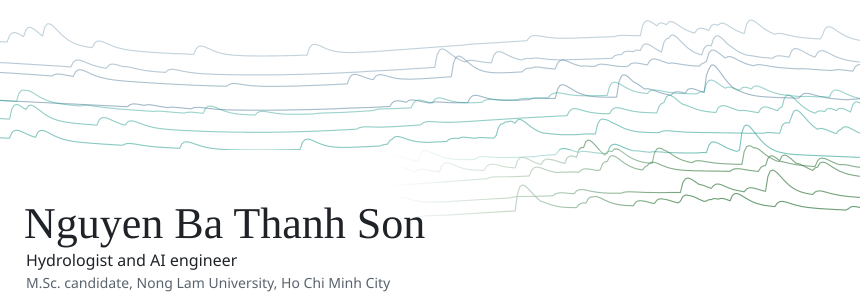
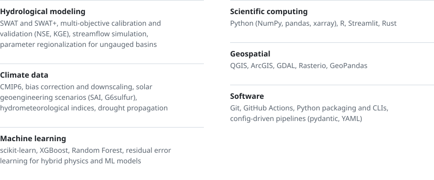

<picture>
  <source media="(prefers-color-scheme: dark)" srcset="./assets/banner-dark.svg">
  
</picture>

  <a href="https://wosonday.id.vn/">Website</a> ·
  <a href="https://www.linkedin.com/in/son-thanh-ba-nguyen-03b45130b/">LinkedIn</a> ·
  <a href="https://huggingface.co/wosonday">Hugging Face</a> ·
  <a href="https://wosonday.id.vn/2026_09_NguyenBaThanhSon_Resume.pdf">Resume</a> ·
  <a href="mailto:thanhsonmttn@gmail.com">thanhsonmttn@gmail.com</a>

I am an environmental researcher and M.Sc. candidate at Nong Lam University in Ho Chi Minh City, Vietnam. I work on hydrology and climate change, combining physically based models with machine learning to study water resources and food security. Most of my work runs SWAT and SWAT+ on Vietnamese river basins, from calibration and climate scenarios to correcting model error with ML, and I build open-source tools to automate those workflows.

## Research

- Streamflow simulation with SWAT and SWAT+ on the Ba, An Lao and Lo river basins
- Climate change impacts on hydrology with CMIP6, and the effects of solar geoengineering (SAI, G6sulfur) on flow regimes and agricultural drought
- Hybrid physics and ML models: XGBoost residual error learning to correct SWAT streamflow
- Regionalizing SWAT parameters to ungauged basins across Vietnam (NAFOSTED, ongoing)
- Research tooling: [SWATprep](https://github.com/wosonday/swat-preprocessing), [SpySWAT](https://github.com/wosonday/SpySWAT) and [bcflow](https://github.com/wosonday/bcflow)

## Technical skills

<picture>
  <source media="(prefers-color-scheme: dark)" srcset="./assets/skills-dark.svg">
  
</picture>

## GitHub

<picture>
  <source media="(prefers-color-scheme: dark)" srcset="./assets/github-dark.svg">
  
</picture>

## Education

- **M.Sc.** Environmental Resources Management (Master by research), Nong Lam University, 2025 to present
- **B.E.** Environmental Resources Management, Nong Lam University, 2020 to 2024
